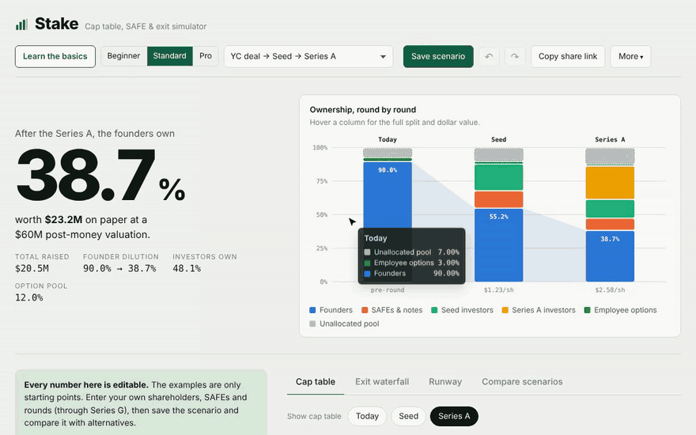
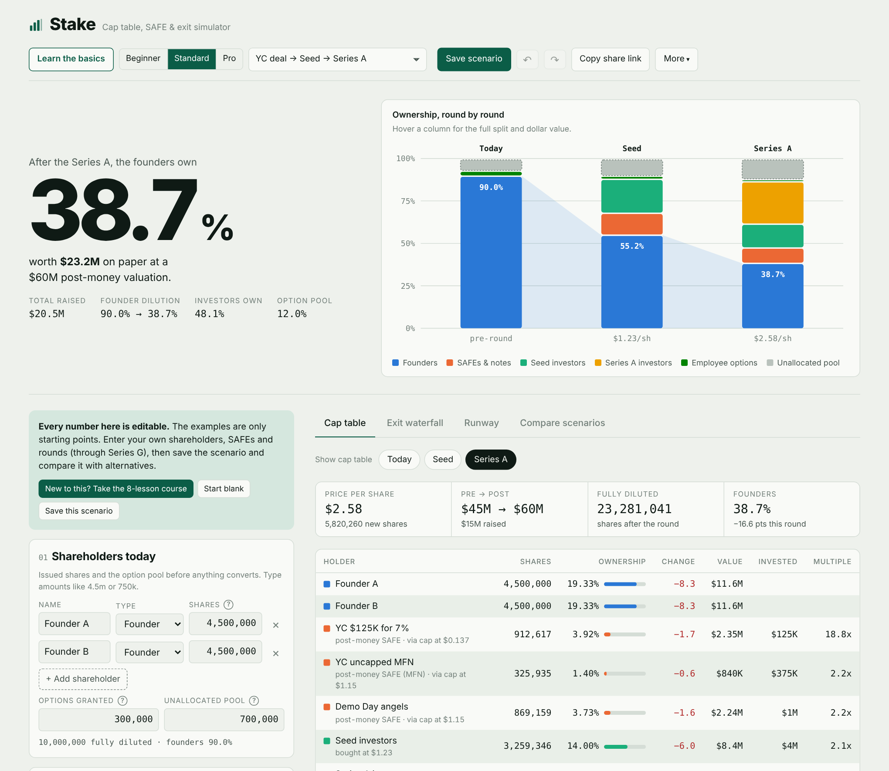
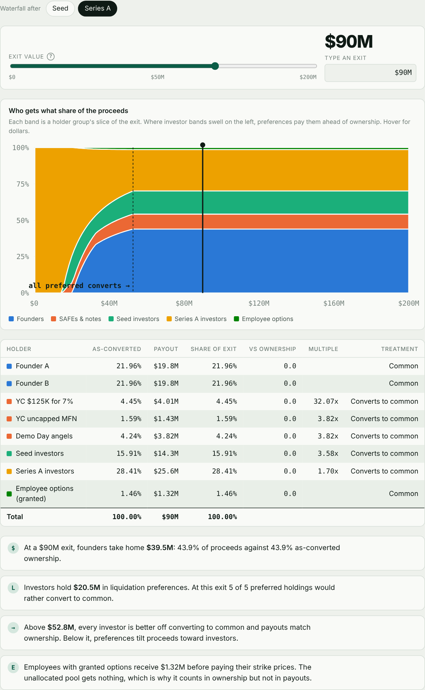
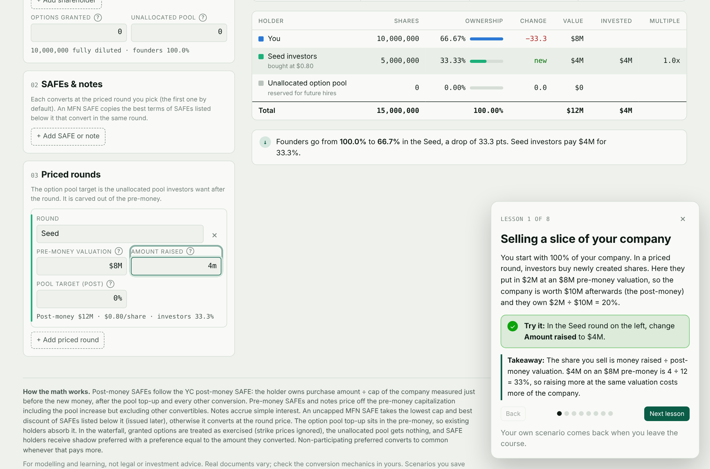

# Stake

**A cap table, SAFE and exit simulator for founders.** See what you actually own after your SAFEs convert, the option pool gets topped up and each round closes, and what you actually take home when the company sells.

[](https://github.com/Aarivg/stake/actions/workflows/ci.yml)


**[Open the live app →](https://aarivg.github.io/stake/)**



## What it does

| | |
|---|---|
| **SAFEs & notes** | Post-money SAFEs (YC), pre-money SAFEs, uncapped MFN SAFEs, convertible notes with interest. Caps, discounts, and bridge SAFEs that convert at a later round. |
| **Priced rounds** | Seed through Series G. Option pool top-ups in the pre-money (the "pool shuffle"), liquidation preferences, participation with caps, and anti-dilution on down rounds (broad-based weighted average or full ratchet). |
| **Exit waterfall** | Drag an exit value and see every holder's payout. Preferences are paid by seniority; non-participating preferred converts when that pays more. Shows the exit value above which every investor converts. |
| **Runway** | Cash, burn, revenue growth. Default alive or dead, the growth rate you'd need to be default alive, and how much to raise for 18 or 24 months. |
| **Scenarios** | Start blank or from an example, save scenarios in your browser, compare up to four side by side, share a scenario as a link, export or import JSON. |
| **Goal seek** | "Keep founders at 50% after the Seed by changing the SAFE cap" → solves for the number and applies it. |
| **Learn mode** | An 8-lesson interactive course for first-time founders: each lesson loads a small example, gives you one thing to change, checks it off when you do, and explains what just happened. Your own scenario comes back when you leave. |
| **Beginner and Pro views** | The app always opens in the Standard view. Beginner hides discounts, liquidation terms and anti-dilution until you use them. Pro adds a two-variable sensitivity table, a command palette (⌘K) and keyboard shortcuts (press ?). |

Results come with plain-English explanations of what they mean for the founders, and the key terms have definitions one hover away. New to cap tables? Press **Learn the basics**. Know them cold? Switch to the **Pro** view and press **⌘K**.







## How the math works

**Post-money SAFE.** The holder owns `amount ÷ post-money cap` of the company's capitalization just before the new money comes in, measured after the pool top-up and every other conversion. That is why the YC $125K SAFE is exactly 7%.

**Pre-money SAFE and notes.** Conversion price = `cap ÷ pre-money capitalization`, including the pool increase and excluding other convertibles. Notes convert principal plus simple interest. The investor gets the lower of the cap price and the discounted round price.

**MFN SAFE.** Copies the lowest cap and best discount of SAFEs issued after it that convert in the same round; with none, it converts at the round price.

**Priced round.** Price per share = `pre-money ÷ pre-money fully diluted shares`. The pool top-up, SAFE and note conversions and any anti-dilution shares all sit in the pre-money, so new investors get exactly `raise ÷ post-money`. The circular dependencies (the pool depends on the price, the price on the conversions, the conversions on the price) are solved by fixed-point iteration.

**Anti-dilution.** Broad-based weighted average: `CP₂ = CP₁ × (A + B) ÷ (A + C)`, where A is fully diluted shares before the round, B the shares the new money would buy at the old price and C the shares it actually buys. Full ratchet reprices to the new round price. If a round can't be priced at all (protected holders plus the pool would need more than the whole pre-money), the app says so instead of returning nonsense.

**Waterfall.** Preferences are paid newest round first (or pari passu). What is left is shared by common, converted holders and participating preferred. A participation cap limits a holder's total payout; above it they convert. Granted options are treated as exercised (strike prices ignored) and the unallocated pool receives nothing.

**Runway.** Month-by-month simulation with compounding revenue and expense growth. Default alive means revenue overtakes expenses before cash runs out, without new money.

All of this is covered by tests in [`tests/`](tests), including YC's own MFN example and hand-solved down rounds.

## Limitations

Stake is for modelling and learning, not legal or investment advice. It doesn't model option strike prices, secondary sales, warrants, pay-to-play, or multiple closes within a round. Real documents vary, so check the conversion mechanics in yours.

## Run it locally

No install needed: open `index.html` in a browser.

To work on the code (Node 18+):

```bash
npm test          # run the math test suite
npm run build     # inline src/ into index.html
npm start         # build and serve locally
```

```
src/engine.js      the cap table math: pure functions, no DOM
src/app/           the interface, one file per feature, concatenated in name order
src/styles/        styles with light and dark themes
src/template.html  page shell
tests/             node:test suites for the engine
scripts/build.js   inlines everything into index.html
index.html         the built single-file app, deployed as is
```

## License

MIT © Aariv Gupta
